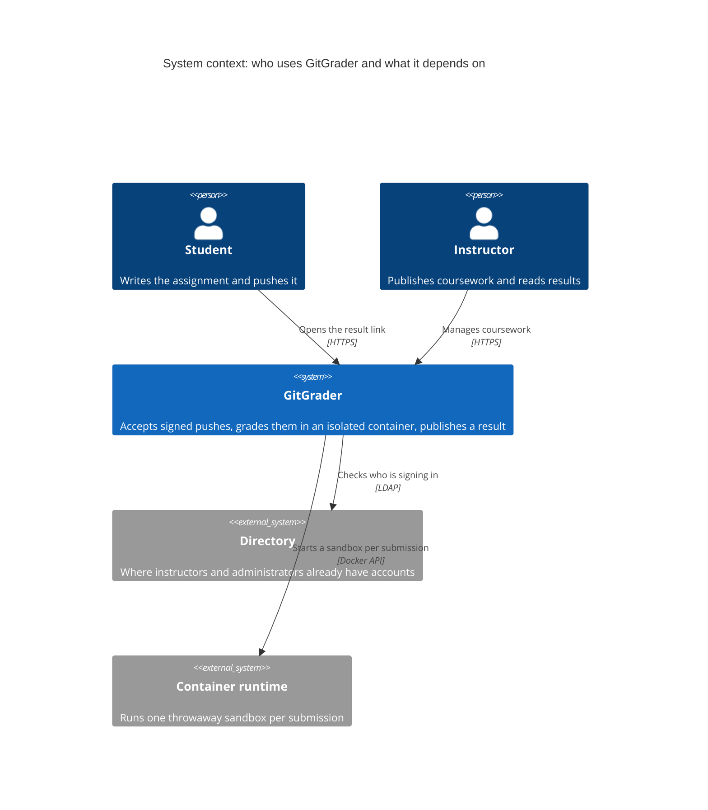

# GitGrader

[](https://github.com/git-grader/gitgrader/actions/workflows/build.yml)
[](https://github.com/git-grader/gitgrader/releases)
[](LICENSE)

GitGrader is a self-hostable platform for courses that accept programming
assignments over Git. Students push signed work over SSH; the service records an
immutable submission, grades it in an isolated container, and publishes a result
link. Instructors manage coursework through a web interface.

## Scope and limitations

GitGrader grades submissions; it does not detect authorship. A verified commit
signature proves that a commit was signed by a key registered to that student,
not that the student wrote the work unaided. Self-registration does not verify
identity either. Use assessment policy, supervision, and review for authorship
claims.

It also runs untrusted student code, which makes runner and host isolation
critical. In the shipped Compose deployment the Docker socket is held only by a
separate runner service that can only grade a submission, so the web application
has no route to the engine. The sandbox runs without network access, capabilities,
or a writable root. Read the [security model](docs/security.md) before letting
anyone else near an instance. A single-process deployment using
`grading.runner=docker` does hold the socket; treat that as development only.

## Quick start

Needs Docker, and JDK 25 the first time so the image can be built.

```sh
git clone git@github.com:git-grader/gitgrader.git
cd gitgrader
./scripts/install.sh --demo
```

That brings up the service on <http://localhost:8080> with a sample course
loaded, so there is something to grade straight away. Sign in as
`instructor` / `password`. To walk the whole path a student takes, follow the
[manual testing guide](docs/manual-testing.md).

Leave off `--demo` for an empty instance. Before anyone else uses it, read
[installation](docs/installation.md): the passwords in `.env` are examples and
the service expects to sit behind HTTPS.



A person is someone using the service; a plain box is the service itself; a
shaded box is a dependency it does not own. Each arrow names what crosses it and
the protocol. Two things stand out: students never get an account (an SSH key
identifies them when pushing, and an unguessable link is the only credential for
a result), and grading is the one place the service reaches outward.

[The architecture guide](docs/architecture.md) covers the containers inside that
box, the modules inside those, and the path a submission takes.

## Features and stack

- Git-over-SSH admission with registered-key and SSHSIG checks.
- Versioned templates, hidden test suites, runtimes pinned by image digest, and
  append-only submissions and grading runs.
- PostgreSQL-backed queue, container runner isolation, opaque result tokens,
  LDAP instructor/admin authentication, audit events, and rate limits.
- Java 25, Spring Boot 4.1.1, Spring Modulith 2.1.1, Spring Security 7.1,
  JGit 7.8.0, Apache MINA SSHD 2.20.0, docker-java 3.7.1, Flyway, PostgreSQL,
  and Testcontainers; Vite 8, React 19, TypeScript, MUI v9, TanStack Query, and
  React Router 8.

Scoring is a percentage of the weight earned: `earned weight / total weight × 100`.
With the default weight of one per test, 7 of 10 tests is **70.0 %**.

## Documentation

**Understand**

- [Architecture](docs/architecture.md)
- [Security model](docs/security.md)
- [Grading runtime protocol](docs/grading-runtime-protocol.md)
- [API conventions](docs/api.md)

**Deploy and operate**

- [Installation](docs/installation.md)
- [Configuration reference](docs/configuration.md)
- [Operations](docs/operations.md)
- [Backup and restore](docs/backup-restore.md)
- [Upgrade](docs/upgrade.md)

**Use**

- [Instructor and administrator workspace](docs/instructor-ui.md)
- [Manual testing](docs/manual-testing.md)
- [End-to-end test](docs/e2e-test.md)

**Contribute and release**

- [Development](docs/development.md)
- [Contributing](CONTRIBUTING.md)
- [Release process](docs/release-process.md)
- [Privacy](docs/privacy.md)
- [Security policy](SECURITY.md)
- [Changelog](CHANGELOG.md)
- [Code of Conduct](CODE_OF_CONDUCT.md)
- [License](LICENSE)
